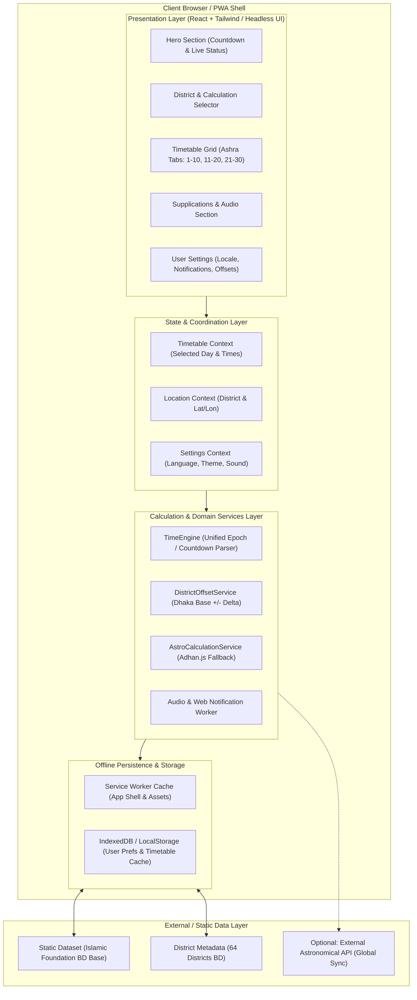
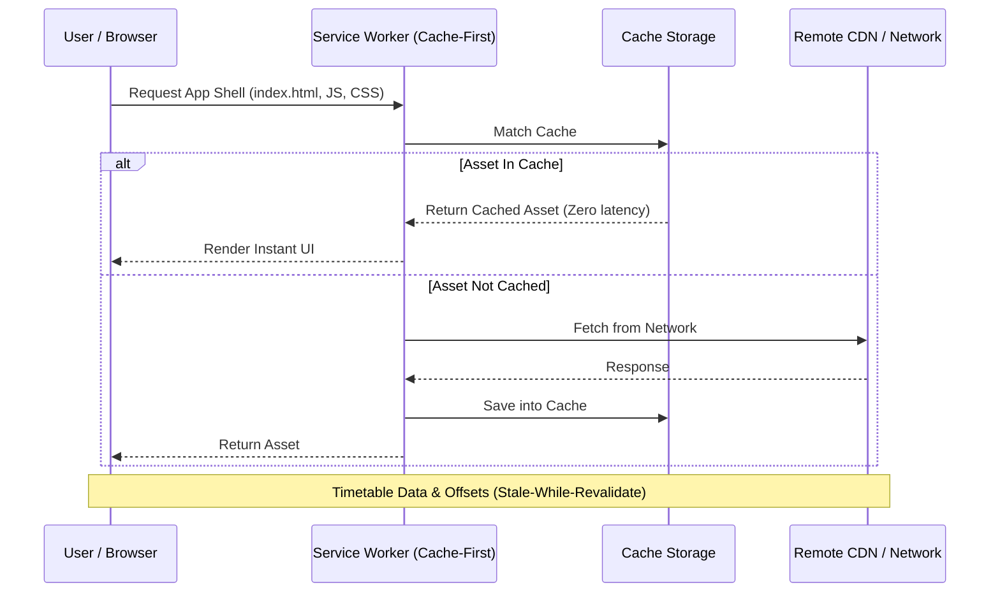
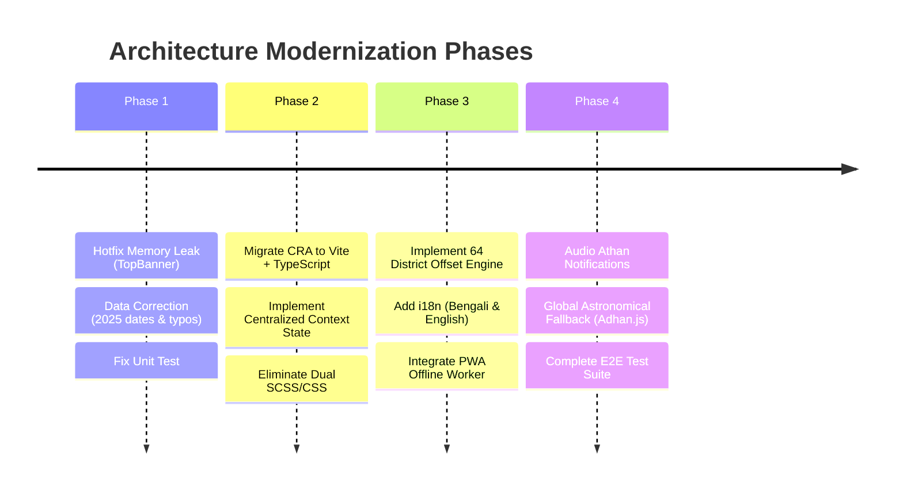

# Ramadan Timetable — System Architecture Documentation

**Document Version:** 2.0.0  
**Status:** Approved Architectural Blueprint  
**Target Platform:** Web (Progressive Web Application — PWA)  
**Primary Focus:** Scalability, Offline-First Reliability, High-Performance Dynamic Calculation, and Domain-Driven Modularity.

---

## 1. System Vision & Objectives

The **Ramadan Timetable** application is engineered to provide accurate, real-time fasting (Sehri) and Iftar schedules, Islamic daily supplications (Duas), and prayer timing utilities for millions of users during the holy month of Ramadan. 

### Core Architectural Goals:
1. **Zero-Latency Availability (Offline-First):** Must function seamlessly without an active internet connection once installed or loaded, ensuring fasting timings are always available at critical times (e.g. Sehri deadline).
2. **Dynamic District Calculation Engine:** Scalable from a single-city (Dhaka) static model to all 64 districts of Bangladesh through mathematical offset calculations, and globally via astronomical calculation algorithms (e.g., Adhan.js).
3. **Domain-Driven Modularity (Vertical Slices):** Modular separation of concerns where timetable calculations, geolocation, supplications, audio notifications, and user preferences are decoupled and independently testable.
4. **Resilient Time & State Precision:** Elimination of unthrottled intervals and locale-dependent string comparisons; utilization of unified epoch time, countdown math, and monotonic time sources.
5. **Universal Accessibility & Multilingual Support (i18n):** Full localization in Bengali (`bn-BD`), English (`en-US`), and authentic Arabic script typography, adhering to WCAG 2.1 AA accessibility guidelines.

---

## 2. High-Level Architectural Overview

The application adopts a **Client-Side Feature-Sliced / Domain-Driven Architecture (Vertical Slice)** backed by a **Progressive Web App (PWA)** offline service layer.



---

## 3. Directory & Module Structure

The project migrates from a flat component directory to a scalable domain-based modular structure:

```
src/
├── app/                          # Application bootstrap & global providers
│   ├── providers/                # Combined providers (Theme, Location, Timetable)
│   ├── App.tsx                   # Top-level composition
│   └── main.tsx                  # Vite / React 18 createRoot entry
│
├── core/                         # Cross-cutting foundational utilities
│   ├── config/                   # Constants, environment variables, default settings
│   ├── types/                    # Common primitive types and generic interfaces
│   ├── utils/                    # Pure utility functions:
│   │   ├── date.ts               # Precision date math, ISO formatting, day/month names
│   │   ├── time.ts               # 12h/24h conversion, epoch diff, countdown formatting
│   │   └── storage.ts            # Typed LocalStorage / IndexedDB wrapper
│   └── errors/                   # Error boundary handlers and fallbacks
│
├── domains/                      # Domain-specific modules (Vertical Slices)
│   │
│   ├── timetable/                # Fasting and prayer schedules
│   │   ├── components/           # TimetableTable, AshraTabs, ScheduleRow, TodayCard
│   │   ├── hooks/                # useTimetable, useTodaySchedule, useAshraFilter
│   │   ├── services/             # timetableParser.ts, timeValidator.ts
│   │   ├── types/                # TimetableEntry, AshraType, DailySchedule
│   │   └── data/                 # dhaka_base_2025.json (Base ground truth)
│   │
│   ├── location/                 # Geolocation, district registry & offset math
│   │   ├── components/           # DistrictPicker, LocationBadge, GeolocationModal
│   │   ├── hooks/                # useCurrentLocation, useDistrictOffset
│   │   ├── services/             # offsetCalculator.ts, geoLookup.ts
│   │   ├── types/                # District, Division, Coordinates, OffsetRule
│   │   └── data/                 # bd_districts.json (64 districts with Sehri/Iftar minute deltas)
│   │
│   ├── countdown/                # High-frequency real-time ticker
│   │   ├── components/           # CountdownClock, NextEventBadge, CircularProgress
│   │   ├── hooks/                # useCountdown, useMonotonicClock
│   │   └── services/             # countdownCalculator.ts (Determines Sehri vs Iftar target)
│   │
│   ├── duas/                     # Supplications & Quranic references
│   │   ├── components/           # DuaCard, AudioPlayButton, CopyDuaButton
│   │   ├── hooks/                # useDuas, useAudioPlayer
│   │   ├── types/                # DuaItem, Transliteration, AudioMetadata
│   │   └── data/                 # authentic_duas.json
│   │
│   └── settings/                 # Personalization & system preferences
│       ├── components/           # LanguageSwitch, ThemeSwitch, NotificationToggle
│       ├── hooks/                # useSettings
│       └── types/                # AppSettings, ThemeMode, SupportedLocale
│
├── shared/                       # Design system & reusable primitives
│   ├── components/               # Button, Modal, Card, Select, Badge, Skeleton, Tooltip
│   ├── hooks/                    # useMediaQuery, useOnlineStatus, useDebounce
│   └── layout/                   # Header, Footer, HeroBanner, Container
│
└── public/                       # Static public assets (icons, manifest, audio chimes)
```

---

## 4. Domain Data Specifications & Type Contracts

### 4.1 Timetable Entry Model
```typescript
export type AshraType = 'rahmat' | 'magfirat' | 'najat';

export interface TimetableEntry {
  readonly id: number;              // 1 to 30 (Ramadan Day)
  readonly hijriDay: number;        // 1 to 30
  readonly gregorianDate: string;   // Strict ISO 8601: "YYYY-MM-DD"
  readonly dayOfWeek: string;       // "Sunday", "Monday", etc.
  readonly ashra: AshraType;        // Ashra classification
  readonly baseTimes: {
    readonly sehriEnd: string;      // 24-hour format: "05:04"
    readonly fajrStart: string;     // 24-hour format: "05:05"
    readonly iftar: string;         // 24-hour format: "18:02"
  };
}
```

### 4.2 District Offset Model (Bangladesh Scalability)
Fasting schedules in Bangladesh are officially published relative to the Islamic Foundation Dhaka schedule. Different districts differ by up to **±15 minutes**:
```typescript
export interface DistrictOffset {
  readonly id: string;              // "chattogram", "sylhet", "rajshahi", etc.
  readonly nameEn: string;          // "Chattogram"
  readonly nameBn: string;          // "চট্টগ্রাম"
  readonly division: string;        // "Chattogram"
  readonly coordinates: {
    readonly lat: number;
    readonly lng: number;
  };
  readonly offsets: {
    readonly sehriMinutes: number;  // e.g. -5 (5 minutes earlier than Dhaka)
    readonly iftarMinutes: number;  // e.g. -6 (6 minutes earlier than Dhaka)
  };
}
```

### 4.3 Dynamic Adjusted Schedule Calculation
```typescript
export interface AdjustedSchedule {
  readonly ramadanDay: number;
  readonly dateISO: string;
  readonly districtId: string;
  readonly sehriTimeString: string;     // Local formatted: "4:59 AM"
  readonly iftarTimeString: string;     // Local formatted: "5:56 PM"
  readonly sehriEpochMs: number;        // Exact UTC millisecond timestamp
  readonly iftarEpochMs: number;        // Exact UTC millisecond timestamp
}
```

---

## 5. Dynamic Engine Architecture

### 5.1 Real-Time Countdown & Monotonic Clock Service
To prevent the catastrophic memory leak and thread-blocking identified in legacy code (`setInterval` running in render loops):

1. **Centralized Single-Interval Worker/Hook:**
   - A single `useMonotonicClock` hook runs a single `requestAnimationFrame` or a 1,000ms `setInterval` managed strictly through `useEffect`.
   - On every tick, it broadcasts the current timestamp to consumers.
2. **Next-Fasting-Event Resolver:**
   ```mermaid
   flowchart TD
       Now["Current Epoch Time (now)"]
       CheckSehri{"now < Today.sehriEpochMs?"}
       CheckIftar{"now < Today.iftarEpochMs?"}
       TargetSehri["Target: Today's Sehri (Fasting Starts)"]
       TargetIftar["Target: Today's Iftar (Fast Breaking)"]
       TargetNextSehri["Target: Tomorrow's Sehri"]

       Now --> CheckSehri
       CheckSehri -- Yes --> TargetSehri
       CheckSehri -- No --> CheckIftar
       CheckIftar -- Yes --> TargetIftar
       CheckIftar -- No --> TargetNextSehri
   ```

### 5.2 District Calculation Engine
Instead of maintaining 64 massive static JSON files, the app uses a **Base-Plus-Delta Strategy**:
$$\text{DistrictTime} = \text{DhakaBaseTime} + \Delta_{\text{DistrictOffset}}$$
- **Payload efficiency:** Only 1 base timetable (~4KB) and 1 district metadata array (~5KB) are downloaded.
- **Compute:** Instantaneous in-memory time arithmetic using timestamp offsets.

---

## 6. Progressive Web App (PWA) & Offline-First Strategy

Fasting deadlines require absolute dependability regardless of network connectivity.



1. **Manifest Configuration:** Standalone display mode with custom theme colors (`#00569a`), app shortcuts for "Today's Schedule" and "Duas".
2. **Cache Targets:**
   - **Pre-cached:** App shell, icons, base fonts (`Quicksand`, Arabic typography).
   - **Runtime Cached:** `dhaka_base.json`, `bd_districts.json`, `duas.json`.
3. **Background Sync:** If notifications are enabled, triggers local system notification 15 minutes before Sehri deadline and at exact Iftar moment.

---

## 7. Security, Quality & Accessibility Standards

### 7.1 Security (SecOps)
- **Zero Third-Party CDN Dependency:** Self-host critical libraries and icons rather than unpkg/jsdelivr to avoid supply-chain attacks and CDN downtime.
- **Secure Links:** Enforce `rel="noopener noreferrer"` across all external anchor tags.
- **Content Security Policy (CSP):** Disallow inline script injection (`'self'`, allowed font domains).
- **Restore Native Browser Ergonomics:** Never disable right-click (`contextmenu`) or copy events.

### 7.2 Accessibility (a11y)
- **Contrast Ratios:** Text colors guarantee minimum 4.5:1 contrast against background cards for both light and dark themes.
- **Semantic Tables:** Timetables rendered using semantic HTML5 `<table>`, `<thead>`, `<tbody>`, `<th scope="col">` with ARIA labels for screen readers.
- **RTL Support:** Proper `<bdo dir="rtl">` for Arabic Duas with specialized typography (e.g., Amiri font) for optimal legibility.

### 7.3 Testing Architecture
- **Unit Testing (Vitest):**
  - Offset calculation math: validating positive, negative, and midnight-rollover deltas.
  - Date parsing: guaranteeing consistency across browser locales (US, UK, BD).
  - Countdown math: testing boundary conditions (exact second of Sehri/Iftar).
- **Component Testing (React Testing Library):**
  - Validating correct render states (Today's card, active Ashra tab, district selection).
- **End-to-End Testing (Playwright):**
  - Offline simulation test: loading app in offline mode and asserting timetable availability.
  - District switch verification: checking that timings update immediately upon district change.

---

## 8. Migration & Modernization Roadmap



---
*Maintained by the Core Engineering Team. For questions or architectural RFCs, open an issue in the project repository.*
