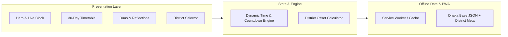

<div align="center">

# 🌙 Ramadan Timetable & Fasting Schedule

**An intelligent, lightweight, and offline-first Ramadan schedule web application featuring dynamic district calculations, live fasting countdowns, and daily authentic supplications (Duas).**

[](https://reactjs.org/)
[](LICENSE)
[](https://ramadan-timetable.netlify.app/)
[](#pwa-support)
[](CONTRIBUTING.md)

[**Live Demo**](https://ramadan-timetable.netlify.app/) • [**System Architecture**](ARCHITECTURE.md) • [**Bug Report**](https://github.com/ri-refat/ramadan-timetable/issues) • [**Request Feature**](https://github.com/ri-refat/ramadan-timetable/issues)

</div>

---

## 📖 Overview

The **Ramadan Timetable** application is engineered to help Muslims effortlessly track their daily fasting schedule throughout the holy month of Ramadan. It provides exact **Sehri (Suhoor) end times**, **Fajr prayer times**, and **Iftar (sunset) times** alongside essential daily supplications with Arabic calligraphy, transliteration, and English translation.

Whether on mobile, tablet, or desktop, the application is designed to be accessible, fast, and reliable—even with intermittent or zero internet connectivity.

---

## ✨ Key Features

- ⏱️ **Real-Time Digital Clock & Today's Schedule:** Automatically matches today's date and highlights current Sehri, Fajr, and Iftar timings with live countdown tickers.
- 📅 **Complete 30-Day Timetable:** Structured into the three traditional Islamic Ashras:
  - **1st Ashra (Days 1–10):** *Rahmat* (Mercy)
  - **2nd Ashra (Days 11–20):** *Magfirat* (Forgiveness)
  - **3rd Ashra (Days 21–30):** *Najat* (Salvation / Freedom from Fire)
- 📍 **District Timing Engine (Bangladesh):** Extensible calculation offset engine supporting timing adjustments across all 64 districts relative to Dhaka base time.
- 🤲 **Authentic Duas & Transliterations:**
  - Niyyah for Fasting (Suhoor Dua)
  - Dua for Breaking Fast (Iftar Dua)
  - Sayyidul Istighfar & daily forgiveness supplications
- 📱 **Mobile-First Responsive Layout:** Fluid design with adaptive grid systems optimized for any viewport.
- ⚡ **Offline-First PWA:** Fast caching strategy ensuring timings are accessible without network connection.
- 🔝 **Smooth Quick Navigation:** Instant scroll-to-top floating control and categorized Ashra filtering.

---

## 🏛️ System Architecture

This project follows an industry-grade, domain-driven **Vertical Slice Architecture** designed for high scalability and modularity.



> 📘 **Detailed Architecture Documentation:**  
> For complete specifications on module boundaries, data contracts, state management, and calculation algorithms, read our comprehensive [**ARCHITECTURE.md**](ARCHITECTURE.md).

---

## 🛠️ Tech Stack

| Technology | Purpose |
| :--- | :--- |
| **React 18** | High-performance component-driven user interface |
| **JavaScript / TypeScript** | Core logic, date arithmetic, and countdown services |
| **Sass / SCSS & CSS Variables** | Modular styling, responsive media queries, and design tokens |
| **React Icons** | Lightweight SVG icon system (`react-icons`) |
| **React Scroll To Top** | Smooth back-to-top floating interaction |
| **Service Worker & PWA** | Offline asset caching and standalone app installation |

---

## 🚀 Getting Started

Follow these instructions to set up and run the project locally.

### Prerequisites

- **Node.js**: `v16.x` or higher (Node 18+ recommended)
- **npm** or **yarn** / **pnpm**

### Installation

1. **Clone the repository:**
   ```bash
   git clone https://github.com/ri-refat/ramadan-timetable.git
   cd ramadan-timetable
   ```

2. **Install dependencies:**
   ```bash
   npm install
   ```

3. **Start the development server:**
   ```bash
   npm start
   ```
   Open [http://localhost:3000](http://localhost:3000) in your browser.

---

## 📜 Available Scripts

In the project directory, you can run:

| Command | Description |
| :--- | :--- |
| `npm start` | Runs the app in development mode at `http://localhost:3000` |
| `npm run build` | Builds the optimized production bundle to the `build/` directory |
| `npm test` | Launches the test runner in interactive watch mode |
| `npm run eject` | Note: this is a one-way operation. CRA ejection is discouraged |

---

## 🗺️ Bangladesh District Timing Offsets

Fasting timings vary across Bangladesh by approximately **±15 minutes** east-to-west compared to Dhaka. The timing engine dynamically computes local schedules using the official Islamic Foundation Bangladesh offset formula:

$$\text{District Sehri} = \text{Dhaka Sehri} + \Delta_{\text{Sehri}}$$
$$\text{District Iftar} = \text{Dhaka Iftar} + \Delta_{\text{Iftar}}$$

### Representative District Offsets:

| District | Sehri Offset | Iftar Offset |
| :--- | :---: | :---: |
| **Dhaka (Base)** | `0 min` | `0 min` |
| **Chattogram** | `-5 min` | `-5 min` |
| **Sylhet** | `-7 min` | `-6 min` |
| **Mymensingh** | `+1 min` | `-1 min` |
| **Rajshahi** | `+7 min` | `+6 min` |
| **Khulna** | `+4 min` | `+3 min` |

---

## 🗺️ Project Roadmap

- [x] Ramadan 30-day timetable presentation (Dhaka base)
- [x] Authentic Duas with Arabic text and English translation
- [x] Responsive layout for mobile and desktop
- [ ] **Phase 1 (Stabilization):**
  - [ ] Eliminate `setInterval` render leak in `TopBanner`
  - [x] Sanitize `data.json` for all 30 days of Ramadan 2026
  - [ ] Fix locale-dependent date lookup (`toLocaleDateString`)
- [ ] **Phase 2 (Architecture Modernization):**
  - [ ] Migrate build system from CRA to **Vite**
  - [ ] Introduce strict **TypeScript** typings
  - [ ] Centralize timetable data via React Context API
- [ ] **Phase 3 (District Engine & Offline):**
  - [ ] Complete 64-district interactive selector with live offsets
  - [ ] Full Progressive Web App (PWA) offline installation
  - [ ] Audio Athan / alert notifications 15 minutes before Sehri & at Iftar
- [ ] **Phase 4 (Localization):**
  - [ ] Full Bengali (`bn-BD`) and English (`en-US`) language toggle

---

## 🤝 Contributing

Contributions make the open-source community a fantastic place to learn, inspire, and create. Any contributions you make are **greatly appreciated**.

1. Fork the Project
2. Create your Feature Branch (`git checkout -b feature/AmazingFeature`)
3. Commit your Changes (`git commit -m 'Add some AmazingFeature'`)
4. Push to the Branch (`git push origin feature/AmazingFeature`)
5. Open a Pull Request

---

## 📄 License

Distributed under the **MIT License**. See `LICENSE` for more information.

---

## 👨‍💻 Author & Contact

**Rafiul Islam Refat**  
- Portfolio: [rirefat.netlify.app](https://rirefat.netlify.app/)  
- Email: [rirefat.official@gmail.com](mailto:rirefat.official@gmail.com)  
- GitHub: [@rirefat](https://github.com/rirefat)

---

<div align="center">
  <sub>Built with ❤️ and dedication for the Muslim Ummah. May Allah accept our fasting and prayers.</sub>
</div>
